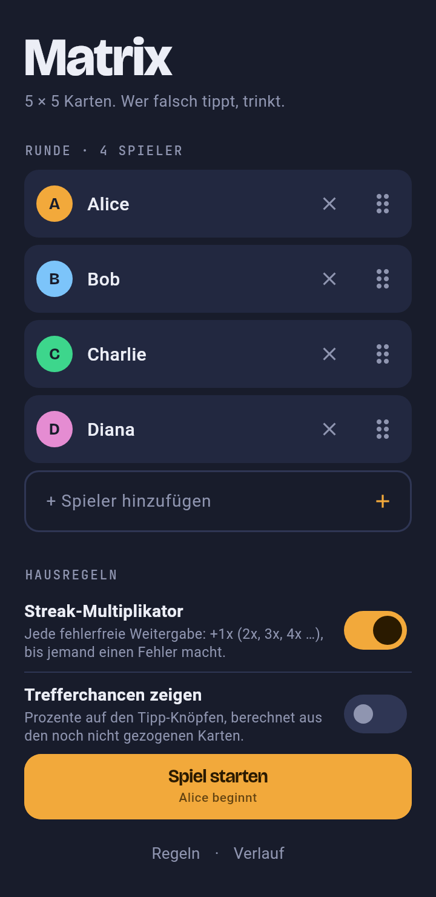
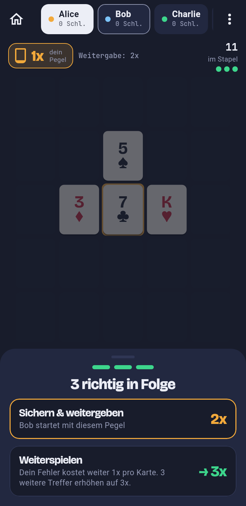
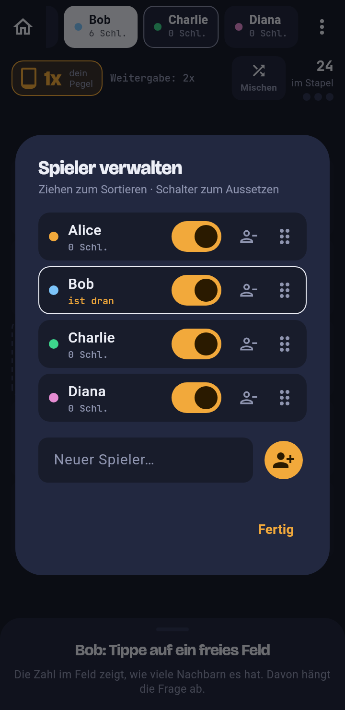
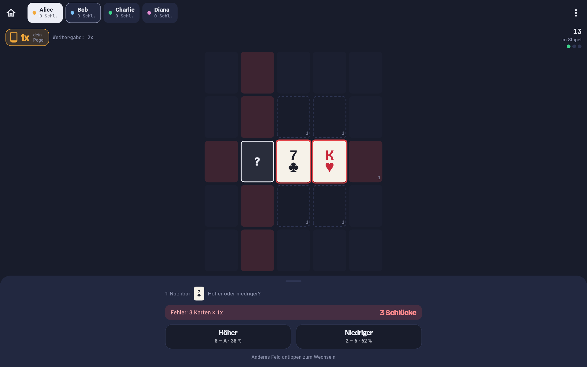

# Matrix – Das Kartentrinkspiel 🍺

Eine Flutter-App für das Kartentrinkspiel **Matrix**. Gespielt wird mit einem klassischen 52-Karten-Deck auf einem 5×5-Raster. Spieler platzieren Karten, machen Vorhersagen und sammeln Strafpunkte – je besser man trifft, desto höher der Multiplikator.

---

## Spielprinzip

Eine Startkarte (Nucleus) wird in der Mitte des 5×5-Rasters platziert. Spieler wählen reihum ein freies, gültiges Feld (angrenzend an eine bereits liegende Karte) und machen eine Vorhersage über die nächste Karte. Die Art der Vorhersage hängt von der Anzahl der Nachbarkarten ab:

| Nachbarn | Vorhersage-Optionen |
|----------|---------------------|
| 1        | Höher (▲) / Niedriger (▼) als Nachbar |
| 2        | Dazwischen / Außerhalb der Nachbar-Range |
| 3        | Hat die Farbe / Hat die Farbe nicht (mindestens einer der Nachbarn) |
| 4        | Exakte Farbe (♥ ♠ ♦ ♣) |

**Richtig geraten** → Karte wird platziert, Zug geht weiter. Nach 3 richtigen Anrufen in Folge kann der Spieler seinen Zug beenden oder weitermachen (mit Multiplikator).

**Falsch geraten** → gesamte Zeile und Spalte der Fehlposition werden geleert. Die Strafpunkte berechnen sich aus `geräumte Karten × geerbter Multiplikator`.

Abgeräumte Karten kommen zurück in den Stapel, der danach automatisch einmal gemischt wird. Das Spiel endet, wenn die **5×5-Matrix voll** ist oder es über das Menü **manuell beendet** wird. Gewonnen hat, wer die **wenigsten Strafpunkte** hat.

---

## Features

- 🃏 Echte Kartenoptik auf einem 5×5-Tisch, freie Felder zeigen ihre Nachbarzahl
- 🎯 Risiko vor dem Tipp: Zeile und Spalte werden markiert, die Schlücke stehen im Tipp-Sheet
- 🍺 Pegel-Anzeige für den Multiplikator, inkl. Wert für die Weitergabe
- 🔥 Hausregel **Streak-Multiplikator**: jede fehlerfreie Weitergabe +1x (2x, 3x, 4x …)
- 📈 Optionale Trefferchancen, berechnet aus den noch nicht gezogenen Karten
- 💀 Fehler als Vollbild – der Bestätigen-Knopf ist immer ohne Scrollen sichtbar
- 👥 Spieler mit eigener Farbe – auch im laufenden Spiel hinzufügen, entfernen, umsortieren oder aussetzen lassen
- 🔀 Stapel mit fester Reihenfolge, jederzeit per Klick mischbar; nach einem Fehler wandern die abgeräumten Karten zurück und der Stapel wird mit Animation gemischt
- 🏁 Spielende bei voller Matrix oder per „Spiel beenden“ – wird im Verlauf gespeichert
- 📊 Auswertung mit Rangliste, Highlights, Fehler-Verlauf und Revanche
- 📖 Regel-Seite für neue Mitspieler

---

## Screenshots

| Start | Spielfeld | Fehler |
|-------|-----------|--------|
|  |  |  |

| Entscheidung | Spieler verwalten | Auswertung |
|--------------|-------------------|------------|
|  |  |  |

**Tablet (Querformat)**



Neu gelegte Karten klappen mit einer 3D-Drehung auf, abgeräumte Karten blenden aus, und der Fehler-Screen wackelt kurz. Animationen lassen sich in den Hausregeln abschalten.

---

## Voraussetzungen

- [Flutter SDK](https://flutter.dev/docs/get-started/install) ≥ 3.0.0
- Dart SDK ≥ 3.0.0
- Android Studio / Xcode (für Emulator oder physisches Gerät)

---

## Installation & Start

```bash
# Abhängigkeiten installieren
flutter pub get

# App auf verbundenem Gerät / Emulator starten
flutter run
```

### Tests ausführen

```bash
flutter test
```

---

## Builds mit GitHub Actions

| Workflow | Wann | Ergebnis |
|----------|------|----------|
| **APK bauen** (`build-apk.yml`) | Push auf `main`, Pull Requests, manuell | Tests + signierte APK (ARM) als Artefakt `matrix-apk` |
| **Release** (`build-release.yml`) | Tag `v*` oder manuell | App Bundle + APK, GitHub-Release, optional Upload in Google Play |

Der Google-Play-Upload läuft nur im Release-Workflow und nur, wenn das Secret `PLAY_SERVICE_ACCOUNT_JSON` gesetzt ist – sonst wird er übersprungen.

### 1. Secrets hinterlegen

*Repository → Settings → Secrets and variables → Actions → New repository secret*

| Secret | Inhalt |
|--------|--------|
| `ANDROID_KEYSTORE_BASE64` | Upload-Keystore als Base64: `base64 -w0 upload-keystore.jks` (macOS: `base64 -i upload-keystore.jks`) |
| `ANDROID_KEYSTORE_PASSWORD` | Passwort des Keystores |
| `ANDROID_KEY_ALIAS` | Alias des Schlüssels |
| `ANDROID_KEY_PASSWORD` | Passwort des Schlüssels |
| `PLAY_SERVICE_ACCOUNT_JSON` | *(optional)* JSON-Key eines Google-Cloud-Service-Accounts, dem in der Play Console Release-Rechte für die App gegeben wurden |

Bei aktivierter **Play App Signing** gehört hier der *Upload-Key* hin, nicht der App-Signing-Key von Google.

Optionale **Variables** (gleiche Seite, Tab *Variables*):

| Variable | Standard | Zweck |
|----------|----------|-------|
| `VERSION_CODE_OFFSET` | `0` | Wird zur Anzahl der Commits addiert, falls in Play schon höhere versionCodes existieren |
| `PLAY_TRACK` | `internal` | `internal`, `alpha`, `beta` oder `production` |
| `PLAY_RELEASE_STATUS` | `draft` | `completed` erst, wenn die App in der Play Console bereits veröffentlicht ist |

### 2. Release auslösen

```bash
git tag v1.1.0
git push origin v1.1.0
```

Der Tag bestimmt den `versionName` (`1.1.0`). Der `versionCode` ist in beiden Workflows die Anzahl der Commits – er steigt also immer, und eine APK aus „APK bauen“ lässt sich über eine Release-APK installieren und umgekehrt. Fehlen die Signing-Secrets, bricht ein Release-Tag ab; „APK bauen“ signiert dann mit dem Debug-Key.

### APK herunterladen

*Actions → APK bauen → Lauf auswählen → Artifacts → `matrix-apk`*. Darin liegt `matrix-<version>-<build>-arm.apk` für alle gängigen Android-Handys. Manuell starten: *Actions → APK bauen → Run workflow*.

### Lokal signiert bauen

`android/key.properties` anlegen (ist in `.gitignore`):

```properties
storeFile=/pfad/zu/upload-keystore.jks
storePassword=...
keyAlias=...
keyPassword=...
```

```bash
flutter build apk --release --target-platform android-arm,android-arm64
```

---

## Projektstruktur

```
lib/
├── domain/
│   └── models.dart          # Datenmodelle: Card, Deck, Position, Guess
├── engine/
│   └── game_engine.dart     # Spiellogik: Platzierung, Guess-Auswertung, Failure-Mechanik
├── l10n/
│   └── app_strings.dart     # Alle sichtbaren Texte
├── providers/
│   ├── game_provider.dart   # Spielzustand, Multiplikator, Streak, Vorschau-Werte
│   └── settings_provider.dart # Hausregeln & Einstellungen
├── screens/
│   ├── setup_screen.dart    # Start: Spieler, Hausregeln
│   ├── game_screen.dart     # Spieltisch, Sheets, Fehler-Vollbild
│   ├── scoreboard_screen.dart # Auswertung & Revanche
│   ├── history_screen.dart  # Verlauf gespeicherter Spiele
│   └── rules_screen.dart    # Regeln
├── theme/
│   └── app_theme.dart       # Farb- und Schrift-Tokens, ThemeData
├── widgets/
│   ├── card_face.dart       # Kartenvorderseiten
│   ├── game_board.dart      # 5×5 Tisch (passt sich immer ohne Scrollen ein)
│   ├── guess_controls.dart  # Tipp-Sheet inkl. Wertebereichen & Chancen
│   ├── player_info_bar.dart # Spielerleiste & Pegel
│   ├── settings_dialog.dart # Hausregeln-Liste & Einstellungsdialog
│   └── sheet.dart           # Bottom-Sheet, Knöpfe, Auswahlkacheln
└── main.dart                # App-Einstiegspunkt & Routing
```

---

## Abhängigkeiten

| Paket | Version | Verwendung |
|-------|---------|------------|
| [provider](https://pub.dev/packages/provider) | ^6.1.1 | State-Management |
| [shared_preferences](https://pub.dev/packages/shared_preferences) | ^2.2.2 | Lokale Persistenz |
| [cupertino_icons](https://pub.dev/packages/cupertino_icons) | ^1.0.6 | Icons |

---

## Architektur

Die App folgt einem **MVVM-Muster** mit Provider:

- **Model**: `domain/models.dart` und `engine/game_engine.dart` kapseln die gesamte Spiellogik und sind UI-unabhängig.
- **ViewModel**: `GameProvider` hält den gesamten App-State und stellt Methoden für die UI bereit.
- **View**: Screens und Widgets reagieren auf State-Änderungen über `context.watch` / `context.read`.
